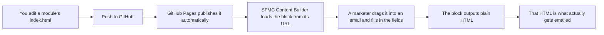

# Milwaukee Custom Blocks — Developer Guide

This guide is for anyone who needs to work on these files — whether you're a developer building a new block from scratch, or someone who's landed here to fix a typo, change a colour, or swap out a broken link. You don't need to know Salesforce Marketing Cloud inside and out to use this guide. Read the first few sections to understand what you're looking at, then jump to whichever part covers the job you're trying to do.

## Contents

1. [What this repository is](#what-this-repository-is)
2. [From code change to live email](#from-code-change-to-live-email)
3. [Finding your way around](#finding-your-way-around)
4. [Making a small tweak](#making-a-small-tweak)
5. [Testing a change before you publish it](#testing-a-change-before-you-publish-it)
6. [Publishing your change](#publishing-your-change)
7. [Understanding a module's code](#understanding-a-modules-code)
8. [The shared toolkit](#the-shared-toolkit)
9. [Building a brand new module](#building-a-brand-new-module)
10. [Email coding rules of thumb](#email-coding-rules-of-thumb)
11. [When something goes wrong](#when-something-goes-wrong)
12. [A few terms explained](#a-few-terms-explained)

---

## What this repository is

Milwaukee's marketing team builds emails in a tool called **Salesforce Marketing Cloud (SFMC)**, using something called **Content Builder**. Content Builder lets them drag ready-made pieces — a banner, a button, a product feature — into an email and fill in the text, images and links themselves, without touching any code.

Those draggable pieces are called **custom blocks**, and this repository is where they live. Each folder (`full-width-button`, `stats`, `checklist`, and so on) is one block. Inside each folder is a single `index.html` file that contains everything needed to run that block: the form the marketer fills in, and the code that turns their answers into the actual HTML that ends up in the email.

You don't need to install anything to work on this project. There's no build step, no compiling, no package manager — you edit the HTML/CSS/JavaScript files directly and that's the finished product.

## From code change to live email

The pipeline, end to end:



Two things worth noting:

- **There's no separate deploy step.** As soon as a change lands on the `main` branch, GitHub Pages picks it up and it's live — no approval gate. That's convenient, but it also means a typo goes live just as fast as a fix, so check your work locally first (see [Testing a change before you publish it](#testing-a-change-before-you-publish-it)).
- **The editing screen and the final email are two different things.** The buttons, colour pickers and text boxes a marketer sees are just a form for collecting information. What actually gets sent is a separate chunk of plain HTML that the block builds from that form's answers. Changing how an email *looks* almost always means changing the HTML it builds, not the form itself.

## Finding your way around

```
milwaukee_custom-blocks_2025/
├── DEVELOPER_GUIDE.md        ← this file
├── _base-template/           ← copy this folder to start a new block
├── shared-assets/            ← code and styles every block relies on — see below
├── full-width-button/        ← one folder per block, each with its own index.html
├── stats/
├── checklist/
├── ...                       ← and so on for every other block
```

Every block folder follows the same pattern:

| File | What it's for |
|------|----------------|
| `index.html` | The whole block — editing form, logic, and the email HTML it produces |
| `icon.png` | The icon marketers see for this block in Content Builder |
| `dragIcon.png` | The icon shown while a marketer is dragging the block into place |

A couple of folders are exceptions worth knowing about:

- **`legacy-header/`** contains an extra file, `ampscript.html`. That's not a custom block at all — it's AMPscript (SFMC's own scripting language) used for personalising the header logo based on subscriber data. Treat it separately from everything else in this guide.
- **`shared-assets/`** isn't a block — it's a set of files that every block links to, so they don't each need their own copy. More on this in [The shared toolkit](#the-shared-toolkit).

## Making a small tweak

Most requests that land on someone's desk are small: change some wording, swap a colour, fix a link, adjust some spacing. Here's how to approach the common ones.

**Before you start:** open the block's `index.html` in your editor and look for a function called `generateTemplate()`. This is almost always where you need to make your change — it's the function that builds the actual email HTML. Everything above it in the file is the editing form (what the marketer sees); `generateTemplate()` is the output (what the customer sees).

### Changing default text or wording

Search the file for `moduleConfig` near the top. It lists every field the block has, along with a `defaultValue` for each one — this is the text that appears the first time someone drags the block into an email. Change the `defaultValue` and you've changed the starting text. This won't affect emails that have already been built with different text typed in — it only changes what a fresh copy of the block starts with.

### Changing a colour

Milwaukee's two brand colours are used everywhere:

- Red: `#DB011C`
- Black: `#000000` (sometimes `#313131` for softer text)

Search the file for the hex code you want to change (e.g. `#DB011C`) and you'll usually land right in `generateTemplate()` or a related style block. Double-check you're not changing a colour that's tied to a "Red vs Black" option the marketer can already choose in the form — in that case you'd change both values, not just one.

### Fixing or updating a link

Links usually come from a URL field the marketer fills in, so there's often nothing to fix in the code at all — the fix is just typing the correct URL into the field in Content Builder. If you're looking for a *hardcoded* link (one that's baked into the code rather than typed in by a marketer), search the file for `href=` or `http` and you'll find it inside `generateTemplate()`.

### Adjusting spacing

Look for a "Spacer" option in the module's fields (many blocks let a marketer choose spacing of `both`, `desktop`, `mobile` or `none`), or look inside `generateTemplate()` for `<td>` elements with a `height` set, or inline `padding` in a `style` attribute. Email spacing is done with actual pixel heights and padding rather than CSS margins — see [Email coding rules of thumb](#email-coding-rules-of-thumb) for why.

### Shared files affect every block

The `shared-assets/` folder is used by every single block. Editing `quill-config.js` or `customblock-styles.css` changes behaviour across the whole project, not just the block you're working on. If a fix only applies to one block, make it in that block's own `index.html` instead.

## Testing a change before you publish it

You can preview any block in a normal browser without needing access to SFMC. From the root of the repository:

```bash
python3 -m http.server 8000
```

Then open `http://localhost:8000/[module-name]/` — for example `http://localhost:8000/full-width-button/`.

This loads the block's editing form so you can click around, type into fields, and check nothing is visibly broken or throwing errors. Keep the browser's developer console open (F12, or right-click → Inspect) while you test, and watch for errors in red.

**What this local preview can and can't tell you:**

- It's great for confirming the form works, the preview updates as you type, and there are no JavaScript errors.
- It won't tell you how the block looks inside a real email. Some blocks behave differently once SFMC and actual email clients (Outlook, Gmail, Apple Mail) get involved. For anything more than a text or colour tweak, it's worth also checking the block inside a real Content Builder email and, ideally, sending yourself a test email before it goes out to customers.

## Publishing your change

Once you're happy with a change, commit it and push it to `main`:

```bash
git add .
git commit -m "Describe what you changed and why"
git push
```

GitHub Pages will pick up the update automatically — there's no separate build or approval step. Give it a minute or two, then refresh the block inside Content Builder to see your change reflected there. If a marketer already has an email in progress using that block, their existing content isn't affected — only newly added copies of the block (or the "starting" defaults) change.

## Understanding a module's code

Once you're past quick tweaks and want to understand a block properly, it helps to know that every `index.html` is organised the same way, top to bottom:

1. **The SFMC handshake** — a single line of script near the top of the file that tells SFMC "I'm ready", so Content Builder doesn't time out while the rest of the page loads. Leave this alone.
2. **Editor styles** (`<style>` block) — CSS for the form marketers see while editing. This never appears in the final email.
3. **The HTML form** — the actual fields, buttons and inputs a marketer interacts with.
4. **`moduleConfig`** — a JavaScript object listing every field the block has: its type (text, URL, rich text, number, toggle...), its default value, and any limits (like a maximum character count).
5. **`state`** — keeps track of things while the form is open, like which rich text editors are currently active, so they can be cleaned up properly later.
6. **`initializeEditors()`** — sets up any rich text boxes using the shared `QuillConfigManager` (see below).
7. **`generateTemplate()`** — the important one. Takes everything the marketer has filled in and returns the finished email HTML as a string. This is what actually gets sent to customers.
8. **Event handlers** — code that watches for the marketer typing or clicking, and updates the preview and saved data a moment later (deliberately delayed slightly — "debounced" — so it isn't recalculating on every keystroke).

If you're trying to answer "why does this look the way it does in an email?", the answer is almost always inside `generateTemplate()`. If you're trying to answer "why does this field behave a certain way in the editor?", look in `moduleConfig` and the event handlers instead.

## The shared toolkit

A few files in `shared-assets/` are shared by every block, so a fix or improvement made there benefits all of them at once — but also means a mistake there affects everything.

- **`quill-config.js`** provides `QuillConfigManager`, which every block uses for its rich text boxes (the ones with bold/italic/link buttons) instead of each block setting one up from scratch. It also handles turning what someone types into email-safe HTML — for example, making sure pressing Enter produces a visible line break in the final email rather than getting silently stripped out. If you're ever tempted to create a `new Quill(...)` editor directly inside a block, use `QuillConfigManager` instead — see `shared-assets/README.md` for the full API.
- **`customblock-bundle.js`** and **`customblock-styles.css`** hold other shared logic and styling used across blocks (things like the loading spinner, error messages, and general editor layout).

The golden rule: **don't copy these files into an individual block's folder.** If a block needs something different, change how it *uses* the shared file rather than duplicating it — otherwise the copies will drift apart over time and become inconsistent.

## Building a brand new module

If you need an entirely new block rather than a tweak to an existing one, start from the template rather than an existing module:

```bash
cp -r _base-template your-new-module-name
```

The `_base-template/README.md` file walks through customising it — updating `moduleConfig` with your fields, editing the form, and writing your own `generateTemplate()`. It already includes the shared editor setup, cleanup, debouncing and URL validation, so you're not rebuilding any of that from scratch.

A few things worth checking before you consider a new module finished:

- The HTML Editor tab is enabled (`tabs: ['htmlblock']` in the BlockSDK setup), so someone can view/edit the raw HTML if they ever need to.
- Rich text fields use `QuillConfigManager`, not a Quill editor created directly.
- Every input has a debounce (300–400ms) so the preview doesn't lag or recalculate on every keystroke.
- URLs are validated and give visible feedback if invalid.
- The block still works correctly after a page refresh (i.e. saved data loads back in properly).
- You've tested it in a real email, not just the local preview.

## Email coding rules of thumb

Email HTML has to work in some genuinely old and quirky software (Outlook still renders emails using a piece of Microsoft Word, for instance), so the rules are a bit different from building a normal web page:

- **Total width is 620px** — a 20px gutter on each side plus 580px of content.
- **Brand colours:** red `#DB011C`, black `#000000` (or `#313131` for body text).
- **Fonts:** headers use `'Helvetica Neue LT W05_93 Blk E', Arial, sans-serif`; body copy uses `'Helvetica Neue LT W05_55 Roman', sans-serif`.
- **Layout uses tables, not flexbox or grid.** `<table role="presentation" border="0" cellpadding="0" cellspacing="0">` is the standard building block for laying things out, because table support is far more consistent across email clients than modern CSS layout.
- **Spacing uses actual pixels and `&nbsp;`, not margins.** Margins are unreliable in several email clients, so spacing is usually a `<td>` with a fixed `height`, or padding set inline.
- **Styles are inline in the output**, not in a `<style>` block, because many email clients strip out `<style>` blocks entirely.
- **Test across clients** — Outlook (desktop and web), Apple Mail, Gmail (web and mobile), and Thunderbird all render slightly differently. If your change affects layout, it's worth a quick check across at least a couple of these before it goes out widely.

## When something goes wrong

| What you're seeing | Likely cause | What to try |
|---|---|---|
| The rich text editor never appears, or the page looks broken | Quill or `QuillConfigManager` didn't load before the block's own script ran | Check the browser console for errors; confirm the script tags for Quill and `quill-config.js` are present and in the right order |
| You type something but the preview doesn't update | `generateTemplate()` is erroring, or a field name doesn't match between the form and the code | Check the console for errors; make sure the field's `id` in the HTML matches the name used in `moduleConfig` and `generateTemplate()` |
| Line breaks you typed have disappeared in the final email | Content was processed more than once, stripping the `<br>` tags | Make sure `QuillConfigManager.sanitizeForEmail()` (or `getCleanContent()`) is only called once on the way out, not repeatedly |
| Text won't wrap properly on mobile | Leftover non-breaking spaces (`&nbsp;`) in the content | `QuillConfigManager` normally strips these automatically — check the content isn't being handled outside of it |
| A saved block resets to defaults after refreshing | BlockSDK isn't saving or loading data correctly | Check the console for BlockSDK errors, and confirm field names match exactly between the form, `moduleConfig`, and where the data is read back in |
| Everything looks fine locally but breaks inside SFMC | Local preview can't fully simulate Content Builder or real email clients | Test inside an actual email in Content Builder, and send yourself a preview before rolling out |

## A few terms explained

If you're new to email or to Salesforce Marketing Cloud, these come up constantly in this codebase:

- **SFMC (Salesforce Marketing Cloud)** — the platform Milwaukee's marketing team uses to build and send emails.
- **Content Builder** — the part of SFMC where marketers assemble emails by dragging blocks and content into place.
- **Custom block** — a reusable, drag-and-drop component (like the ones in this repository) that appears inside Content Builder.
- **BlockSDK** — the small library SFMC provides that lets a custom block talk to Content Builder: saving and loading the marketer's data, resizing the editing window, and so on.
- **Quill** — the open-source rich text editor (the bold/italic/link toolbar) used for any free-text field in these blocks.
- **`QuillConfigManager`** — this project's own wrapper around Quill, so every block sets it up the same consistent way instead of repeating the same setup code everywhere.
- **Debounce** — waiting a short pause (e.g. 300ms) after someone stops typing before reacting, rather than reacting on every single keystroke. Keeps things smooth and avoids unnecessary work.
- **Sanitize** — cleaning up HTML before it's used in an email, so it's safe and displays consistently (e.g. converting a paragraph break into a `<br>` tag that email clients understand).
- **AMPscript** — SFMC's own scripting language, used for things like personalisation. Only `legacy-header/ampscript.html` in this repository uses it; everything else is plain HTML/CSS/JavaScript.

---

### Where to go next

- `_base-template/README.md` — building a new module, field types, and a full troubleshooting/testing checklist for template-based work.
- `shared-assets/README.md` — the full `QuillConfigManager` API, with examples.
- The existing modules themselves are the best reference for real, working patterns — `full-width-button/` and `checklist/` are good starting points if you want to see a simple and a moderately complex example side by side.
